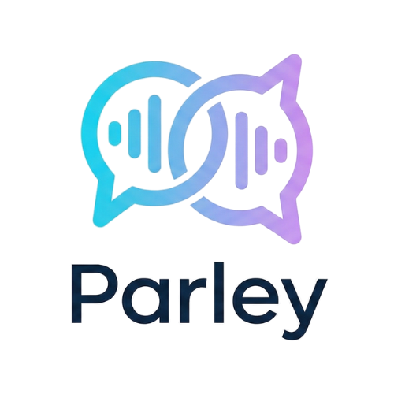
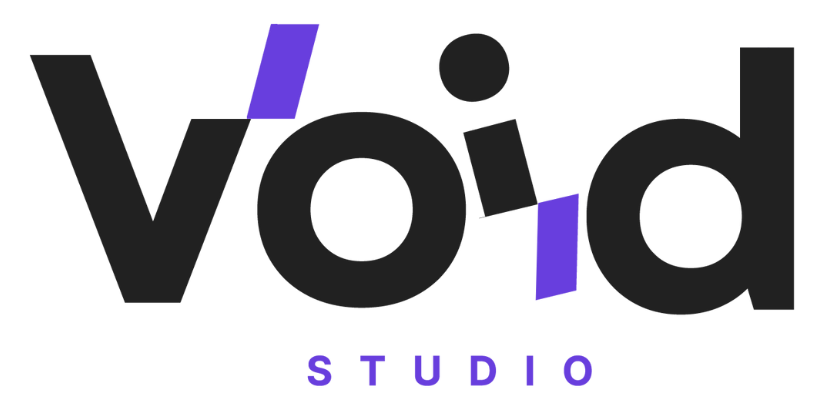

<div align="center">

  

  <p align="center">
    <strong>Quebre barreiras linguísticas.</strong><br/>
    Tradução simultânea voz-para-voz de alta fidelidade e tempo real.
  </p>

  <p align="center">
    <a href="LICENSE"></a>
    
    
    
  </p>

</div>

---

## Visão Geral

O **Parley** é um aplicativo multiplataforma desenvolvido em **Flutter** para realizar traduções simultâneas de voz bidirecionais (Português e Inglês) em tempo real, com síntese de fala imediata e interface limpa e intuitiva.

Construído sob padrões rigorosos de engenharia de software, o projeto adota arquitetura em camadas (Clean Architecture / MVVM), blindagem de credenciais via `.env`, separação estrita de responsabilidades e desacoplamento de dependências externas.

---

## Funcionalidades

- **Reconhecimento de Voz Contínuo:** Captura de áudio nativa com tratamento de permissões e feedback visual de status.
- **Tradução Bidirecional em Tempo Real:** Motor de tradução com baixa latência entre Português e Inglês.
- **Síntese de Voz (TTS):** Reprodução automática ou sob demanda do áudio traduzido com suporte a instâncias de áudio compartilhadas e Bluetooth.
- **Design System Padronizado:** Interface responsiva com gradientes institucionais, animações fluidas de transição e foco em legibilidade.
- **Isolamento de Credenciais:** Configuração de endpoints e parâmetros por variáveis de ambiente (`.env`), sem exposição de segredos em código-fonte.

---

## Arquitetura do Projeto

O código-fonte segue separação de responsabilidades em camadas no padrão Flutter:

```text
lib/
├── core/
│   ├── config/          # Carregamento e validação de variáveis de ambiente (.env)
│   ├── constants/       # Identificadores de assets, localidades e constantes de UI
│   └── theme/           # Design System, paletas de cores e temas globais
├── data/
│   ├── models/          # Modelos de domínio imutáveis (TranslationItem)
│   └── services/        # Serviços externos desacoplados (Speech, TTS, Translation)
├── ui/
│   └── features/
│       ├── splash/      # Tela de abertura animada (SplashScreen)
│       └── translation/ # Módulo principal de tradução
│           ├── view_models/  # Gerenciamento de estado e regras de apresentação (MVVM)
│           ├── views/        # Telas e layouts principais (ParleyScreen)
│           └── widgets/      # Componentes atômicos reutilizáveis (ChatBubble, MicButton, etc.)
└── main.dart            # Ponto de entrada e inicialização assíncrona
```

---

## Instalação e Execução

### Pré-requisitos
- [Flutter SDK](https://flutter.dev/docs/get-started/install) (`>= 3.0.0 < 4.0.0`)
- [Dart SDK](https://dart.dev)
- Dispositivo físico ou emulador com suporte a microfone

### Passo a Passo

1. **Clonar o repositório:**
   ```bash
   git clone https://github.com/pedrodavi120/parley-app.git
   cd parley_app
   ```

2. **Configurar as variáveis de ambiente:**
   Copie o modelo de ambiente disponível em `.env.example`:
   ```bash
   cp .env.example .env
   # No Windows PowerShell:
   Copy-Item .env.example .env
   ```

3. **Instalar dependências:**
   ```bash
   flutter pub get
   ```

4. **Executar a suíte de testes:**
   ```bash
   flutter test
   ```

5. **Iniciar o aplicativo:**
   ```bash
   flutter run
   ```

---

## Configuração de Variáveis de Ambiente (.env)

Todas as credenciais e parâmetros operacionais são controlados via `.env`. O arquivo `.env` está explicitamente bloqueado no `.gitignore` para prevenir vazamentos.

| Variável | Padrão | Descrição |
| :--- | :--- | :--- |
| `APP_NAME` | `Parley` | Nome exibido na aplicação |
| `APP_ENV` | `development` | Ambiente de execução (`development`, `staging`, `production`) |
| `SPEECH_LISTEN_TIMEOUT_SECONDS` | `20` | Duração máxima de escuta contínua do microfone |
| `SPEECH_PAUSE_SECONDS` | `2` | Intervalo de silêncio para encerramento de captura |
| `DEFAULT_SOURCE_LOCALE` | `pt_BR` | Código de localidade para português |
| `DEFAULT_TARGET_LOCALE` | `en_US` | Código de localidade para inglês |
| `TRANSLATION_API_KEY` | *(opcional)* | Chave para serviços dedicados de tradução em nuvem |
| `TRANSLATION_API_URL` | *(opcional)* | Endpoint customizado da API de tradução |

---

## Qualidade de Código e Testes

O projeto adota política de **Zero Warnings** na análise estática e cobertura por testes automatizados:

```bash
# Executar análise estática
flutter analyze

# Executar suíte de testes unitários e de widgets
flutter test
```

---

## Contribuição

Diretrizes detalhadas sobre branching, convenção de commits (Conventional Commits) e padrões de código estão documentadas em [CONTRIBUTING.md](CONTRIBUTING.md).

Para a política de segurança e reporte de vulnerabilidades, consulte [SECURITY.md](SECURITY.md).

---

## Licença

Este projeto é distribuído sob os termos da licença **MIT**. Consulte o arquivo [LICENSE](LICENSE) para obter o texto integral.

---

<div align="center">

  <p>Desenvolvido por</p>
  <a href="https://www.voidstudio.com.br" target="_blank" rel="noopener noreferrer">
    
  </a>
  <p><a href="https://www.voidstudio.com.br" target="_blank" rel="noopener noreferrer"><strong>www.voidstudio.com.br</strong></a></p>

</div>
